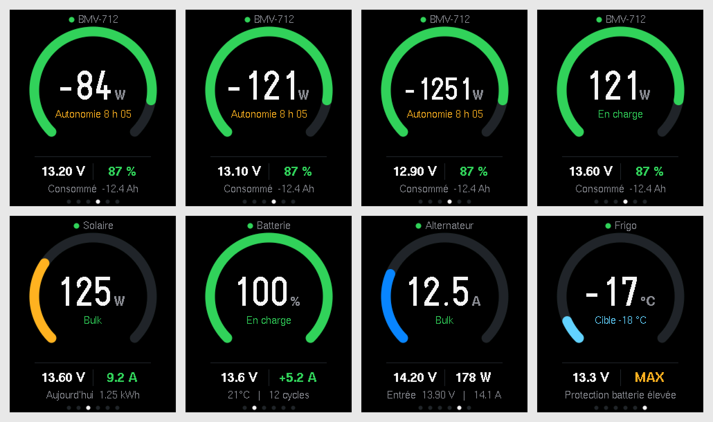
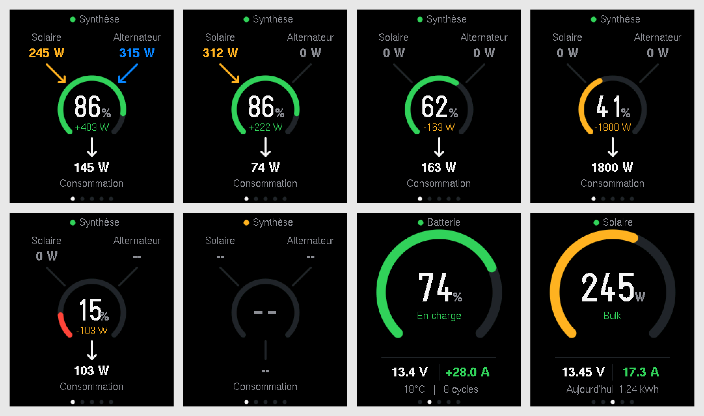

# van_dashboard : tableau de bord énergie Bluetooth pour van / camping-car

Petit écran tactile qui affiche en direct, sans câble ni Internet, l'état de l'installation électrique :
batterie lithium, panneaux solaires, chargeur alternateur, consommation et frigo à compresseur.
Tout est lu en Bluetooth Low Energy par une carte **Waveshare ESP32-C6-Touch-LCD-1.83**.
Chaque équipement s'active ou non selon ce que contient votre installation.




## Pages

| Page | Source | Ce qui est affiché |
|------|--------|--------------------|
| Synthèse | Victron | flux d'énergie : solaire et alternateur vers la batterie, consommation |
| Batterie | BMS Creabest / CBT Power « VB » | charge en %, tension, courant, température, cycles |
| Solaire | Victron SmartSolar MPPT | puissance, phase de charge, production du jour |
| BMV-712 | Victron BMV-712 | puissance consommée ou reçue en W, autonomie, état de charge |
| Alternateur | Victron Orion XS | courant de charge, tensions d'entrée et de sortie |
| Frigo | frigo à compresseur famille Alpicool (testé sur EZA Blizz-E F65) | température, consigne, tension, mode ECO / MAX |

Seules les pages des équipements activés dans `config.h` apparaissent. La synthèse apparaît dès qu'un appareil Victron est activé.
La pastille à côté du titre passe à l'orange quand l'appareil ne donne plus de nouvelles.

## Matériel

- Carte [Waveshare ESP32-C6-Touch-LCD-1.83](https://www.waveshare.com/wiki/ESP32-C6-Touch-LCD-1.83) (écran 240 x 284, tactile, boutons BOOT et PWR).
- Un câble USB-C.
- Facultatif : une batterie LiPo 3,7 V sur le connecteur de la carte.

Appareils lus, tous facultatifs (au moins un à activer) :

- batterie LiFePO4 avec BMS CBT Power (nom Bluetooth commençant par `VB`, par exemple Creabest) ;
- Victron SmartSolar MPPT, BMV-712, Orion XS (ou tout appareil Victron compatible « Instant Readout ») ;
- frigo à compresseur piloté par l'application BLIZZ-E, Alpicool ou équivalente (nom Bluetooth du type `A1-...`, `WT-...`, `AK1-...`).

## Installation

### 1. Arduino IDE

1. Installer [Arduino IDE 2](https://www.arduino.cc/en/software).
2. Sur un Mac Apple Silicon, si la compilation échoue avec `ctags: bad CPU type in executable`, installer Rosetta :
   ```bash
   softwareupdate --install-rosetta --agree-to-license
   ```
3. **Arduino IDE > Settings**, champ *Additional boards manager URLs*, ajouter :
   ```
   https://espressif.github.io/arduino-esp32/package_esp32_index.json
   ```
4. **Boards Manager** : installer **esp32** d'Espressif (testé en 3.3.12).
5. **Library Manager** : installer
   - **GFX Library for Arduino** (testé en 1.6.9) ;
   - **U8g2** (testé en 2.36.19), pour les polices.

### 2. Récupérer le projet

Le dossier doit s'appeler `van_dashboard`, comme le fichier `.ino` :

```bash
cd ~/Documents/Arduino
git clone https://github.com/<votre-compte>/van_dashboard.git
```

### 3. Réglages personnels

Copier `config.example.h` en `config.h`, puis le remplir. `config.h` contient vos clés : il est exclu du dépôt par `.gitignore`.

```bash
cd ~/Documents/Arduino/van_dashboard
cp config.example.h config.h
```

Commencer par déclarer ce que contient le van, `1` = présent, `0` = absent :

```cpp
#define USE_BATTERY 1   // batterie à BMS CBT Power
#define USE_FRIDGE 1    // frigo à compresseur
Victron vic[] = {
  {"Solaire",     1, "aa:bb:cc:dd:ee:ff", "<clé>"},
  {"BMV-712",     0, "", ""},   // pas de BMV-712 : page absente
  {"Alternateur", 1, "aa:bb:cc:dd:ee:ff", "<clé>"},
};
```

Un équipement à `0` n'a pas de page et la carte ne le contacte jamais. Puis remplir les réglages des équipements présents :

| Réglage | Où le trouver |
|---------|---------------|
| `BATTERY_NAME` | nom Bluetooth de la batterie (dans l'application du fabricant, ou ligne `Bluetooth vu` du Serial Monitor) |
| `FRIGO_NAME` | nom Bluetooth du frigo (`A1-...`), pas le surnom donné dans l'application. Laisser `""` pour prendre le premier frigo reconnu, puis le fixer avec la ligne `Frigo retenu` du Serial Monitor |
| `vic[]` | pour chaque appareil Victron, dans VictronConnect : appareil > Paramètres (engrenage) > menu (3 points) > Infos produit > *Instant readout via Bluetooth* > Afficher. Recopier l'adresse MAC et la clé de chiffrement (32 caractères). Le titre (1er champ) est libre |
| `PV_MAX_W` | puissance crête des panneaux, pour la jauge Solaire |
| `ORION_MAX_A` | courant maximal de l'Orion XS, pour la jauge Alternateur |
| `SLEEP_MS` | délai avant mise en veille de l'écran (5 min par défaut) |

Fixer `FRIGO_NAME` est conseillé : sur un camping, sinon, le frigo d'un voisin pourrait être pris.

### 4. Téléverser

Dans **Outils** :

| Menu | Valeur |
|------|--------|
| Board | **ESP32C6 Dev Module** |
| USB CDC On Boot | **Enabled** |
| Partition Scheme | **Huge APP (3MB No OTA/1MB SPIFFS)** |
| Port | `/dev/cu.usbmodem...` (Mac) ou `COMx` (Windows) |

Puis **Téléverser**. Le nom du port peut changer d'une connexion à l'autre : en cas d'erreur `port is busy or doesn't exist`, le choisir à nouveau.

Équivalent en ligne de commande :

```bash
arduino-cli compile -b esp32:esp32:esp32c6:CDCOnBoot=cdc,PartitionScheme=huge_app van_dashboard
```

## Utilisation

| Action | Effet |
|--------|-------|
| Glisser vers la gauche, toucher, bouton BOOT | page suivante |
| Glisser vers la droite | page précédente |
| Glisser vers le haut / le bas | plus / moins lumineux (réglage mémorisé) |
| Bouton PWR, appui court | éteint ou rallume l'écran |
| Bouton PWR, appui de 6 s | arrêt de la carte |

L'écran se met en veille après `SLEEP_MS` sans action. Un appui le rallume sans changer de page.

## Fonctionnement

- **Victron** : rien n'est connecté. La carte écoute les annonces chiffrées « Instant Readout » (AES-128-CTR) et les déchiffre avec la clé de chaque appareil. VictronConnect reste utilisable en même temps.
- **Batterie** : connexion permanente, demande d'état toutes les 5 s.
- **Frigo** : connexion de quelques secondes une fois par minute. **Seule la demande d'état est envoyée** : le croquis ne contient aucune commande de réglage et ne peut rien changer sur le frigo.
  Le frigo n'accepte qu'une connexion à la fois : fermer l'application du frigo sur le téléphone (voire couper son Bluetooth) pour que la carte puisse le lire.

## Dépannage

Ouvrir le **Serial Monitor** (115200 bauds). La carte y écrit :

- `Bluetooth vu : <nom> (<adresse>)` : appareils détectés, utile pour trouver les noms à mettre dans `config.h` ;
- `Frigo retenu`, `Frigo : ...` : détection et lecture du frigo ;
- `cle incorrecte` : la clé Victron ne correspond pas à l'adresse indiquée ;
- `Dessin : ... memoire libre ...` : toutes les 10 s, temps d'affichage et mémoire disponible.

| Symptôme | Piste |
|----------|-------|
| Page Frigo sur « Recherche du frigo » | application du frigo encore connectée ; mauvais `FRIGO_NAME` |
| Page Victron à `--` | appareil hors de portée, clé ou adresse MAC erronée, Instant Readout désactivé dans VictronConnect |
| Page Batterie à `--` | mauvais `BATTERY_NAME`, ou application de la batterie connectée |
| Téléversement impossible | choisir à nouveau le port ; sinon maintenir BOOT en branchant le câble |

## Structure

| Fichier | Rôle |
|---------|------|
| `van_dashboard.ino` | affichage, tactile, boutons, Bluetooth |
| `victron.h` | déchiffrement des annonces Victron |
| `frigo.h` | décodage des trames du frigo |
| `config.example.h` | modèle des réglages personnels |
| `config.h` | vos réglages (non publié) |

## Crédits

Protocoles repris de :

- [victron-ble](https://github.com/keshavdv/victron-ble) (annonces Victron) ;
- [aiobmsble](https://github.com/patman15/aiobmsble) (BMS CBT Power) ;
- [FridgeKit](https://github.com/jgalea/fridgekit) et [Alpicool50l12vfridgefreezer](https://github.com/dandwhelan/Alpicool50l12vfridgefreezer) (frigo).

Projet personnel, sans lien avec Victron, Creabest, EZA ou Waveshare.

## Licence

[MIT](LICENSE)
